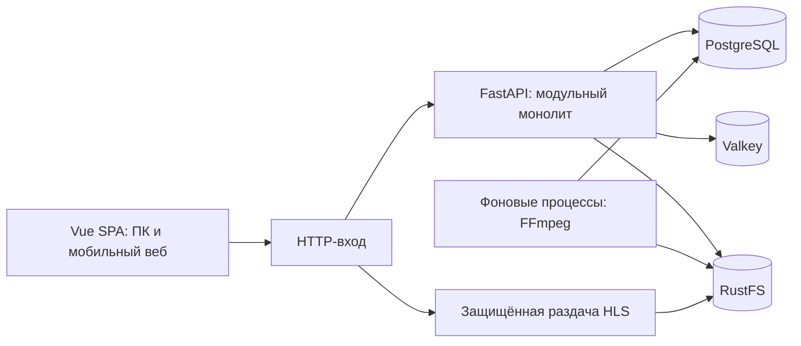

# Обзор проекта

## Назначение

Учебная копия YouTube с максимально близким интерфейсом в пределах заданных
экранов. Цель — построить полноценный путь видео от загрузки до воспроизведения,
а не только каталог карточек. Точные границы — [ТЗ](requirements.md).

## Установленные требования

- ПК и мобильный веб; тёмная тема с возможностью расширить систему тем позднее.
- Python + FastAPI, модульный монолит; clean architecture внутри модулей.
- Vue 3 + TypeScript + Vite, Feature-Sliced Design.
- PostgreSQL — постоянные данные, RustFS — файлы, Valkey — кэш и сессии.
- FFmpeg, фоновые задания, HLS, качества от 360p до 2160p по исходному видео.
- Весь цикл приложения — Docker; `dev` и `prod` наследуются от `base`.
- Деплой на чистую Ubuntu одной командой.

## Общая схема

HTTP-вход реализуется через Nginx; механизм заданий и защищённый медиашлюз
пока не выбраны. Worker использует тот же модульный бэкенд, это не
отдельный бизнес-микросервис. [Границы и зависимости](../backend/architecture.md).

## Продолжение работы

Сначала вопросы по конкретной задаче, затем её реализация. Все нерешённые
параметры находятся в [списке вопросов](../tasks/open-questions.md), а порядок
работ — в [задачах](../tasks/README.md). Созданы минимальные точки входа
FastAPI/Vue и [Docker-конфигурация](../infrastructure/docker.md),
бизнес-функции ещё не реализованы.
